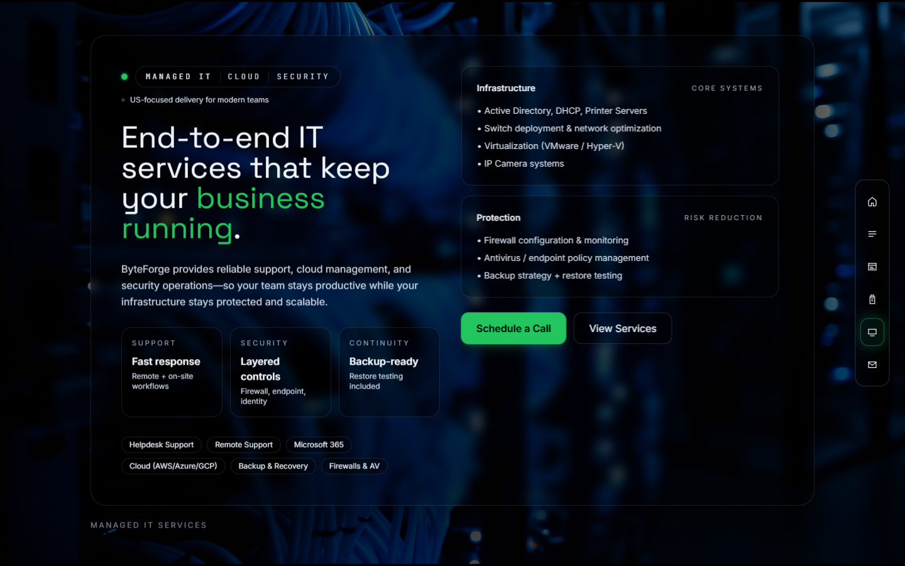

# ByteForge IT

An agency-style website presenting web/app development, AI automation and
managed IT services through a full-page animated interface.


**Scope and status:** this repository contains the presentation website and a
contact-email endpoint. Service descriptions, brand logos and marketing copy
are site content, not independently verified client relationships or delivered
projects. A current public deployment and commercial launch are unverified.
The public `main` checkout is the basis for these captures; newer uncommitted
work in the maintainer's separate checkout is excluded.

## Implementation

The page connects six sections through a shared GSAP scrolling hook: Home,
Interlude, Web/App Studio, AI Systems, Managed IT and Contact. Side navigation
emits a section-change event; the hook bounds the destination and prevents
another transition while one is active. Video layers and Lottie illustrations
provide the visual background.

A shared contact modal is used from the page and Managed IT section. Its
`/api/contact` route uses Nodemailer with Gmail credentials supplied through
server environment variables. Keeping the form element before the asynchronous
request lets a successful response reset and close the modal; a failed response
keeps the entered fields available for retry.

See [page composition](app/page.js),
[scroll navigation](app/hooks/useFullPageScroll.js) and
[contact form](app/components/shared/ScheduleCallModal.js).



## Run locally

Verified with Node.js 24.11.1 and npm 11.6.2 on Windows. The lockfile pins Next.js
16.0.3 and React 19.2.0; other dependencies include GSAP, Lottie, Tailwind CSS 3
and Nodemailer.

```sh
git clone https://github.com/boyInShadows/byteForgeIT.git
cd byteForgeIT
npm ci
npm run dev
```

Open <http://localhost:3000>. Visual preview does not require credentials.
Mail delivery requires `GMAIL_USER` and `GMAIL_APP_PASSWORD` in the server
process environment; keep secrets out of repository files. The current route
uses a recipient fixed in its source. No real email was sent during this review.

```sh
npm run lint
npm run build
npm start
```

## Verification and remaining work

On 2026-10-30, a clean locked install and production build passed. Lint exited
zero with two existing scrolling-hook dependency warnings; build also reported
outdated browser-baseline data. A browser regression reproduced the successful
contact response leaving the modal open, then passed after the form-reference
fix. An intercepted failure preserved fields, and an intercepted retry reset
and closed the form. Desktop section navigation and screenshots were checked
in Edge. SMTP delivery, physical mobile usability and full accessibility were
not verified.

The contact API currently has basic required-field checks; production input
validation, abuse controls and error disclosure need further review. The Managed
IT `View Services` button requests an out-of-range step and remains a known
navigation issue. A dated npm audit found 18 dependency advisories (1 critical,
12 high, 4 moderate, 1 low); no bulk upgrade was performed.

The existing GitLab-sync workflow mirrors the `ramtin` branch; it is not a lint,
test or build quality check. There is no repository test script or quality CI.
Existing history and asset/dependency credits remain intact; this documentation
does not assign a license or sole authorship of the site's assets.
